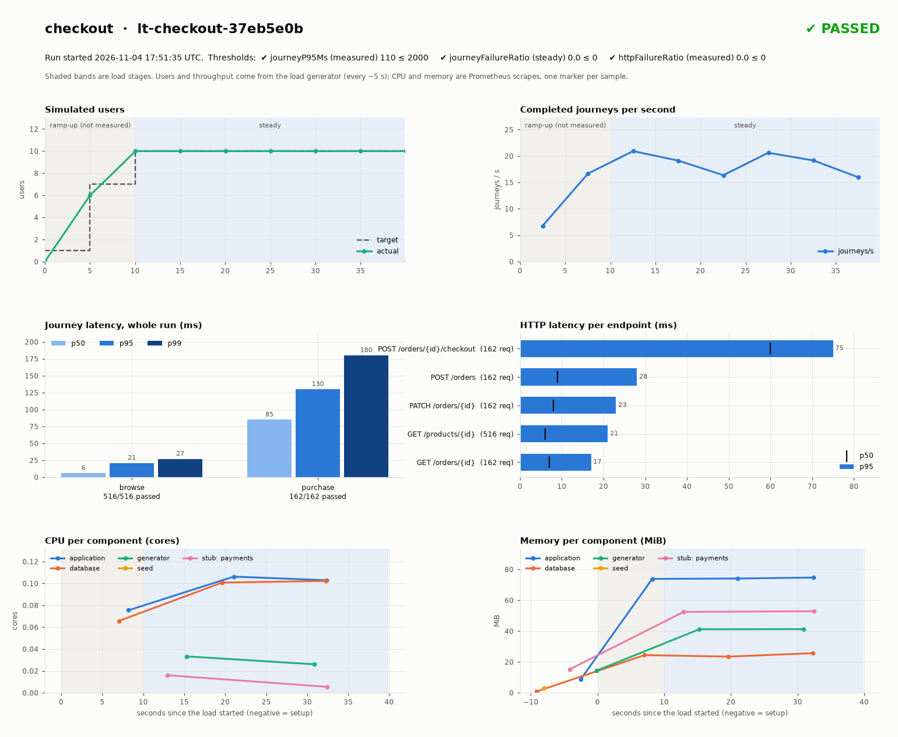

# Self-service load testing on Kubernetes

Product teams describe a load test in a few YAML files and Python functions, then run it with one
command. The platform creates an isolated namespace, deploys the service with a freshly seeded
PostgreSQL and stub dependencies, runs the load, reports pass/fail, and deletes everything,
with resource and network guardrails enforced by Kubernetes.

- Design, decisions and trade-offs: [WRITEUP.md](WRITEUP.md)
- How AI was used: [AI-USAGE.md](AI-USAGE.md)

## Prerequisites

| Tool | Version | Notes |
| --- | --- | --- |
| [Docker](https://docs.docker.com/get-started/get-docker/) | running | Docker Desktop or Colima; give it at least 4 CPUs and 8 GB memory |
| [kind](https://kind.sigs.k8s.io/docs/user/quick-start/#installation) | 0.24+ | local Kubernetes in Docker (enforces NetworkPolicy) |
| [kubectl](https://kubernetes.io/docs/tasks/tools/) | 1.31+ | |
| [Helm](https://helm.sh/docs/intro/install/) | 3 or 4 | |
| Python | 3.11+ | `python3` on your PATH |

On macOS with Homebrew: `brew install kind kubectl helm python`. Internet access is needed the
first time, to pull images and the monitoring chart.

## 1. Set up the local environment

```bash
bash platform/setup-local.sh
```

The first run takes about 5–10 minutes; re-running it is safe and much faster. It:

1. checks the prerequisites;
2. installs the `loadtest` command (into `.runtime/`, which Git ignores; `./loadtest` runs it);
3. creates the kind cluster `performance-test` with Prometheus and Grafana;
4. starts a local registry on `localhost:5001` that the cluster can pull from;
5. publishes the platform artifacts (load-generator image, Helm chart, PostgreSQL);
6. publishes the Checkout sample service, its ApplicationDefinition and its TestSuite.

Nothing touches your default kubeconfig; the cluster's credentials stay in `.runtime/`.

## 2. Run a load test

```bash
./loadtest run LoadTestDefinitions/checkout.yaml
```

The sample test runs 10 users, each repeating *browse 3 products → wait 2 s → purchase*, for about
40 seconds. The whole run takes about 70 seconds and shows live progress (abbreviated):

```text
[1/11] Checking Kubernetes access
[2/11] Resolving and validating artifacts
       Resource plan: 5 Pods, limits 4500m CPU / 1536Mi (namespace allows 8 CPU / 8Gi)
[3/11] Creating an isolated namespace
       Guardrails applied: LimitRange/run-limits, ResourceQuota/run-quota, NetworkPolicy/default-deny, ...
[4/11] Starting PostgreSQL and preparing seed data
[5/11] Deploying supporting services
[6/11] Deploying application and waiting for readiness
[7/11] Running the workload
       Stage steady: 20/40s workload | users 10/10 target | journeys 230 | failed 0 | measured
       Threshold measured/journeyP95Ms: passed (actual=110, max=2000, samples=572)
[8/11] Collecting diagnostics   [9/11] Removing run resources   [10/11] ...   [11/11] ...
PASSED | execution=completed | performance=passed | cleanup=ok | exit=0
```

## 3. See the results

Each run keeps its results in `.runtime/runs/<run-id>/`, after the namespace is deleted
(see [what a run produces](#what-a-run-produces) below).

The exit code is meant for CI: `0` passed, `1` thresholds failed, `2` infrastructure error,
`3` passed but cleanup failed, `130` cancelled.

To watch the cluster in Grafana during a run:

```bash
kubectl --kubeconfig .runtime/performance-test/kubeconfig -n monitoring port-forward svc/monitoring-grafana 3000:80
```

Then open http://localhost:3000 (user `admin`; password: see
[platform/cluster/README.md](platform/cluster/README.md#open-grafana-and-prometheus)).

## 4. See a guardrail stop a test (optional)

Copy the sample and ask for a load generator bigger than a container may be:

```bash
sed "s/limits: {cpu: '1',/limits: {cpu: '3',/" LoadTestDefinitions/checkout.yaml > .runtime/too-big.yaml
./loadtest run .runtime/too-big.yaml
```

It stops in under a second, before anything is deployed:
`suite/suite: cpu limit 3 exceeds the per-container maximum 2`. Every test namespace also gets
a default-deny NetworkPolicy, so load cannot reach anything outside the test.
Details: [guardrails](docs/design/guardrails.md).

## 5. Write your own test

Teams only touch three folders:

| Folder | You write | Guide |
| --- | --- | --- |
| `ApplicationDefinitions/` | How your service runs: image, env, replicas or autoscaling, resources | [README](ApplicationDefinitions/README.md) |
| `TestSuites/<name>/` | User journeys as Python functions, plus test data | [README](TestSuites/README.md) |
| `LoadTestDefinitions/` | One test: application and suite by name, database seed, stubs, load, thresholds | [README](LoadTestDefinitions/README.md) |

Publish the first two by name, then run the third:

```bash
./loadtest publish application ApplicationDefinitions/<name>.yaml --version 1.0.0
./loadtest publish suite TestSuites/<name> --version 1.0.0
./loadtest run LoadTestDefinitions/<name>.yaml
```

Definitions never contain registry addresses: the platform team's
[platform config](platform/config/local.yaml) says where names are published and which chart,
load-generator, database and stub images to use.

## 6. Clean up

```bash
bash platform/teardown-local.sh            # add --purge to also delete the registry data
```

Run results in `.runtime/runs/` are kept.

## What a run produces

Every run leaves a self-contained folder that stays useful after its namespace is gone. The three
things most people open:

1. **`report.md`**: the readable summary, with pass/fail, thresholds, stages, per-journey latency,
   resource peaks per component and the pinned artifact versions.
   Example: [report.md](example-output/lt-checkout-37eb5e0b/report.md)
2. **Log file**: everything shown in the terminal during the run, step by step, ending with the JSON
   summary (`progress.log` in the run folder).
   Example: [console.log](example-output/lt-checkout-37eb5e0b/console.log)
3. **Dashboard image**: users, throughput, latency per journey and endpoint, and CPU and memory per
   component during the test (`dashboard.png`, also shown at the top of `report.md`).
   Example: [dashboard.png](example-output/lt-checkout-37eb5e0b/dashboard.png)

   

The folder also holds `testresult.json` (structured result for CI), `metrics/` (Prometheus
samples, including a CSV), `guardrails.json`, `resolved/` (every artifact pinned to a digest) and
`diagnostics/` (every container's log and the Kubernetes events).

**Browse a complete real run: [example-output/](example-output/README.md).**

## Run it in CI

[`.github/workflows/load-test.yml`](.github/workflows/load-test.yml) (manual dispatch) does the
same on a GitHub runner: creates a temporary kind cluster and registry, publishes, checks that the
cluster enforces the guardrails, runs the test, puts the report in the job summary, uploads the
evidence even on failure, and deletes everything. [`checks.yml`](.github/workflows/checks.yml)
runs the unit tests on every pull request.

## Repository layout

```
ApplicationDefinitions/    how a service runs in a test          <- teams write
TestSuites/<name>/         user journeys (Python) + test data    <- teams write
LoadTestDefinitions/       one file per test                     <- teams write

platform/                  owned by the platform team
  setup-local.sh           one-command local setup (teardown-local.sh to remove)
  config/                  platform config: registry, cluster, runner/database/stub images
  charts/                  supported Helm charts (http-service)
  cluster/                 kind cluster, monitoring values, init scripts
  runner/                  load-generator image (Locust)
  src/perf_runner/         the CLI: publish, resolve, run, report
  tests/

sample-service/            the Checkout sample service (a team would keep it in its own repo)
example-output/            the complete output of one real run
docs/                      design notes and advanced local examples
```

This prototype targets any Kubernetes cluster: the CLI only talks to the Kubernetes API. Running
it on EKS or GKE needs a cluster whose network plugin enforces NetworkPolicy, the monitoring
values from `platform/cluster/monitoring/`, an OCI registry, and a platform config pointing at
them. Cloud provisioning is not part of this prototype (see [WRITEUP.md](WRITEUP.md#6-what-id-build-next)).

## Developer checks

```bash
.runtime/perf-runner/bin/pip install -r platform/tests/requirements.txt
.runtime/perf-runner/bin/python -m unittest discover -s platform/tests
```

The default suite needs no cluster (Helm must be installed). Tests against the live cluster are
opt-in, for example `RUN_KIND_TEST=1` (full lifecycle) and `GUARDRAILS_KIND_TEST=1`.

## Further reading

- [Entities](docs/design/entities.md) · [Run lifecycle](docs/design/load-test-run.md) ·
  [Guardrails](docs/design/guardrails.md) · [Definitions and artifacts](docs/design/published-definition.md)
- [Load settings](docs/design/load-profile.md) · [Load engine](docs/design/load-engine.md) ·
  [Database preparation](docs/design/database-preparation.md) · [Cluster and monitoring](platform/cluster/README.md)

## Demo video

Attached in the email because I don't think you want to pull a video from a git repo.
