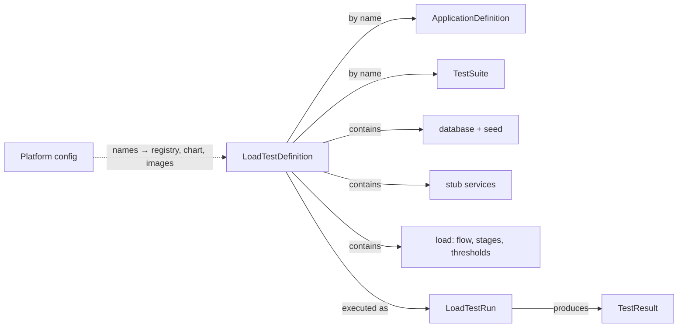
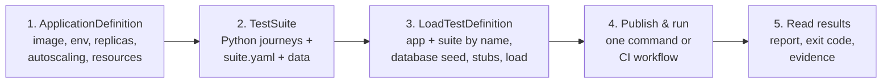

# Self-service ephemeral load testing — writeup

## 1. Context & assumptions

A mid-sized company runs about 50 microservices, owned by product teams. Today every load test
needs a DevOps ticket for setup and teardown. That is slow, uses DevOps time on repetitive work,
and gets skipped when deadlines are tight. The goal: teams load-test on demand, while the
platform enforces its guardrails automatically.

**Functional requirements**

1. Teams define and run their own load tests end to end, with no per-test involvement from the
   platform team.
2. Deploy the team's service from its published container image.
3. Support at least one real dependency: a PostgreSQL database seeded with the team's own data.
4. Describe user behaviour (journeys), the load shape (ramp, hold, number of users) and pass/fail
   thresholds.
5. Return results to the developer: a readable report, a machine-readable result and an exit code.
6. Tear everything down automatically, with no manual step.

**Non-functional requirements**

- **Low friction:** a test is one file. Teams do not need to know Kubernetes, the registry or the
  load engine. Feedback in minutes.
- **Isolation:** each test runs alone. Its resources and network traffic cannot affect other tests
  or other systems.
- **Cost and capacity safety:** every pod and every test has a resource ceiling, checked before
  anything is deployed.
- **Guaranteed teardown:** nothing outlives the test, whatever the outcome.
- **Reproducibility:** the same definition gives a comparable run: fresh seeded data and pinned
  artifact versions.

## 2. Key decisions

1. **Environment: a temporary namespace per run.** Each run gets its own namespace, with
   resources and traffic confined to it. Kubernetes lets the test scale like our services do, and
   its ecosystem makes it easy to add capabilities later (for example chaos testing with Litmus).
   A namespace is also the simplest isolation unit for an MVP: it starts in seconds and costs
   nothing while idle.
2. **Load generator: Locust.** Locust runs as a library inside one shared runner image, so teams
   write journeys as plain Python functions and no extra controller is needed. The definition
   keeps journeys separate from the load shape, so a distributed engine (for example k6 with its
   Kubernetes operator) can replace it later for very high load.
3. **Developer interface: Kubernetes-style YAML.** Every artifact follows the
   [Kubernetes resource model](https://github.com/kubernetes/design-proposals-archive/blob/main/architecture/resource-management.md):
   `apiVersion` for versioning, `kind`, `metadata.name`, `spec`. Resources refer to each other by
   name. It is familiar to engineers, reviewed in Git like code, and used by many internal
   developer platforms.
4. **IaC: Helm + scripts on kind.** The kind cluster, the pinned monitoring stack, the supported
   chart and the guardrail objects are all code, so the whole solution runs and is tested within
   this assessment. I focused on designing the solution from the user's side; cloud provisioning
   is deferred (see §6).
5. **Lifecycle orchestration: a Python CLI.** One command runs the whole lifecycle with native
   Kubernetes objects only, locally or in CI. In production this becomes the CLI plus GitHub
   Actions, or a Kubernetes operator that owns the run.
6. **Dependencies: a seeded PostgreSQL per run, plus platform stubs.** A fresh database is seeded
   by a Job from the team's own image, and downstream HTTP services are replaced by
   platform-supplied stubs with configurable latency and outcome. This is simple, and runs stay
   repeatable without touching shared data.
7. **Artifact delivery: an OCI registry.** Images, the chart, application definitions and suites
   are published by name to one OCI registry and pinned to digests for each run. A local registry
   keeps the flow demoable and testable here; in production, definitions and suites could live in
   S3/GCS behind the same names.
8. **Guardrails: enforced in the cluster, checked before deployment.** A pre-flight check plans
   every pod from the real manifests and rejects an oversized test before anything is deployed.
   The namespace then gets a LimitRange, a ResourceQuota and default-deny NetworkPolicies before
   any workload starts, so Kubernetes enforces them even for pods created outside the CLI.

## 3. Trade-offs

- **Cost.** A shared, always-on cluster has an idle cost, though it is far cheaper than a cluster
  per test. Quotas cap each test, but there is no per-team or monthly budget yet.
- **Complexity.** A CLI is simpler to build, run and test than an operator. But if the CLI is
  hard-killed, its namespace remains until someone runs the `cleanup` command; nothing reconciles
  it automatically.

## 4. System design

Teams write three kinds of resources. The platform team owns everything else: the platform config,
the chart, the runner image and the CLI. Full details: [entity design](docs/design/entities.md).

| Entity | Owner | What it is |
| --- | --- | --- |
| `ApplicationDefinition` | Team | The service under test: image, env, replicas/autoscaling, resources, probes, on a supported chart. |
| `TestSuite` | Team | Named user journeys as Python functions, plus test data. Contains no load settings. |
| `LoadTestDefinition` | Team | One complete test: which application and suite, database and seed, stubs, load and thresholds, limits. |
| Platform config | Platform | Where names are published, and which chart, runner, database and stub images to use. |
| `LoadTestRun` | Generated | One execution: run ID, namespace, pinned versions, progress and evidence. |
| `TestResult` | Generated | Outcome, thresholds, per-journey latency, resource usage, logs. Kept after teardown. |

## 5. User flow

1. **Describe the application** in `ApplicationDefinitions/<name>.yaml`: which image, environment,
   number of replicas or autoscaling, CPU/memory, health checks. Settings that come from the test
   (such as the database URL) are bound by name, never written as secrets.
2. **Write the TestSuite** in `TestSuites/<name>/`: Python functions for each journey (for example
   `browse`, `purchase`), a `suite.yaml` that names them, and optional JSON data.
3. **Write the LoadTestDefinition** in `LoadTestDefinitions/<name>.yaml`. It refers to the
   application and suite by name, adds a database with a seed step and any stubs, and sets the
   load: each user's flow (`browse ×3 → wait 2 s → purchase`), stages (ramp-up, steady hold) and
   thresholds (p95 latency, failure ratios).
4. **Publish and run.** Publish the application definition and suite by name, then run one
   command or the CI workflow. The platform checks the test against its limits, creates an
   isolated namespace, seeds the database, deploys stubs and the service, runs the load, collects
   evidence and deletes the namespace, showing live progress throughout.
5. **Read the results.** The exit code gates CI (0 passed, 1 thresholds failed, 2 infrastructure
   error). `report.md` and `testresult.json` show thresholds, per-journey latency and resource
   peaks, and the evidence folder keeps logs and metrics after teardown.

## 6. What I'd build next

1. **Infrastructure in Pulumi (Python, to match the runner).** Components for the VPC, EKS with
   NetworkPolicy enforcement, a tainted spot node pool for load tests (hard size limit, scales to
   zero), ECR, a GitHub OIDC role and budget alerts. One stack per environment; each stack's
   outputs generate that environment's platform config.
2. **A reusable workflow for team repositories.** One `uses: org/load-testing/...@v1` line plus the
   path to the team's definition. It publishes the team's application definition and suite, runs
   against the shared cluster through OIDC, and posts the report on the pull request.
3. **Load test as a merge-queue gate.** Run on `merge_group` as a required status check: a short
   smoke test in the queue, the full test nightly, and a comparison against the last passing
   `main` run, not only fixed thresholds.
4. **Chaos testing.** An optional `chaos:` section that runs Litmus experiments during a chosen
   stage: kill an application pod, add network latency to the database, make a stub fail part of
   the time. Thresholds cover error rate and recovery time, and namespace isolation keeps the
   experiments contained.
5. **Huge seed data.** Currently we are storing our seed data as csv files under this git repo.
   It's not a good choice when we need a large dataset for seed data, maybe for a huge test case.
   The plan is to support loading the seed data from S3.
   Or think of a pre-built image that already have seed data imported.
