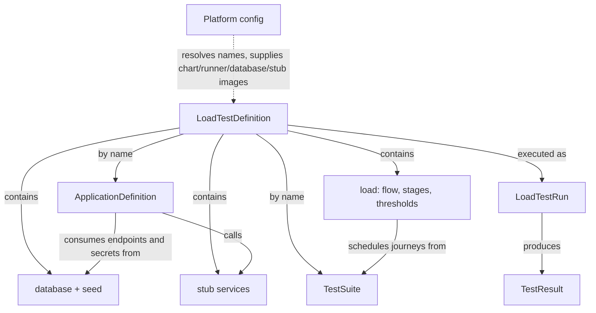

# Architecture entities

Teams write three kinds of resources in Git: an `ApplicationDefinition`, a `TestSuite` and a
`LoadTestDefinition`. All follow the Kubernetes resource shape (`apiVersion`, `kind`,
`metadata.name`, `spec`) and refer to each other **by name**. The platform team owns the
platform config, the supported charts, the runner image and the CLI. Teams publish their
resources by name; each run resolves those names to pinned digests.

| Entity | Owner | Where |
| --- | --- | --- |
| ApplicationDefinition | Team | `ApplicationDefinitions/<name>.yaml` |
| TestSuite | Team | `TestSuites/<name>/` |
| LoadTestDefinition | Team | `LoadTestDefinitions/<name>.yaml` |
| Platform config | Platform | `platform/config/<environment>.yaml` |
| LoadTestRun, TestResult | Generated | `.runtime/runs/<run-id>/` |

## LoadTestDefinition

One complete test: which application and suite (by name, optionally `name:version`), the
database and its seed step, stub services, the load, execution limits and the cleanup policy.
Running a different load means copying the file and changing its `spec.load` section.

**Physical form:** one YAML document validated by a versioned
[JSON schema](../../platform/src/perf_runner/schemas/load-test-definition.schema.json). It holds no
registry addresses; see the [published contract](published-definition.md).

## ApplicationDefinition

The service under test. It selects one of our supported Helm charts and supplies its values:
image, command, ports, resources, replicas or autoscaling, probes, environment, and Secret
bindings for values that come from the test (such as the database URL).

The application itself is the team's: any language, built and published as a container image
by the team. A short image name (`checkout:0.3.0`) lives in the platform registry; a full
reference (`ghcr.io/acme/checkout:1.4`) is used unchanged. `sample-service/` is only the Checkout
sample.

**Physical form:** `ApplicationDefinitions/<name>.yaml` with `spec.chart` (`name`, `version`) and
`spec.values` (inline Helm values). The first supported chart, `http-service`, runs a single HTTP
container; other shapes need additional charts under `platform/charts/`. See the
[AD authoring contract](../../ApplicationDefinitions/README.md).

## Database and stub services

The database is nested in `LoadTestDefinition.spec.database`: an engine `type` and `version`
(PostgreSQL 17.6), a database name and a seed step. The platform supplies the engine image; teams
never pick a database chart. The seed runs as a Job, by default from the application image
(`seed.module`, `seed.args`), or from a separate `seed.image`.

Each run generates its own credentials and exposes outputs (`database.host`, `database.url`, …)
that the application binds by name; credentials stay in a run-owned Secret.

Stub services (`spec.services.<name>`, `type: payment-stub`) replace downstream HTTP
dependencies with configurable `delayMs` and `outcome`. Their image comes from the platform
config, and their URL is bound into the application as `services.<name>.url`. See
[database preparation](database-preparation.md) and the
[local environment example](../examples/local/ENVIRONMENT.md).

## TestSuite

Reusable user journeys: API calls, payloads, authentication, response handling, business
assertions and helpers. It exposes named journeys and contains no traffic volume.

**Physical form:** `TestSuites/<name>/` with `suite.yaml` (journey names mapped to
`module:function`), Python files and optional JSON data. The platform chooses the runner image;
the suite contains only journeys and data. It is published by name as an OCI artifact (not a
container image). At run time the files are delivered to the runner as an immutable,
content-hashed ConfigMap, and the result records the code and data hashes. See
[suite authoring and execution](../../platform/runner/README.md).

The engine is Locust 2.46.6 with closed concurrent users. See the
[engine decision](load-engine.md).

## Load (inside the LoadTestDefinition)

`spec.load` defines how much traffic to generate and what counts as a pass:

- `flow`: the ordered steps every simulated user repeats (`{journey, repeat}` / `{waitSeconds}`);
- `spawnRate` and `drainTimeoutSeconds`;
- `stages`: ramp or hold to a number of users for a duration, and whether the stage is measured;
- `thresholds`: limits such as p95 journey latency and failure ratios, over measured or named stages.

The runner turns this into the engine's internal profile. Stages do not reset the database or
depend on a previous stage passing. See the [load contract](load-profile.md).

## Platform config

Owned by the platform team, one file per environment. It sets the registry prefix where names
are published (`applications/`, `suites/`, `charts/`), whether plain HTTP is allowed (loopback
only), the runner image, database images and stub images. Selected with `--platform` or
`PERF_PLATFORM`; the default is `platform/config/local.yaml`.

## LoadTestRun

One execution of a definition, with a unique ID and namespace. It records the resolved names and
pinned digests, the resource plan, the guardrail objects applied, progress, timestamps and the
result location. Changing a definition never changes an active run.

**Physical form:** a run record (`run.json`) and resolved snapshot, plus live progress logs.
Python tooling manages the Kubernetes resources; no custom resource or operator is required.

## TestResult

The outcome and evidence of a run: threshold results, per-journey and HTTP metrics, execution
errors, collection and cleanup outcomes, resource usage, and logs. Missing or incomplete results
are explicit and never count as a pass.

**Physical form:** `testresult.json`, `report.md` and an evidence folder kept outside the
namespace, so they survive teardown.
