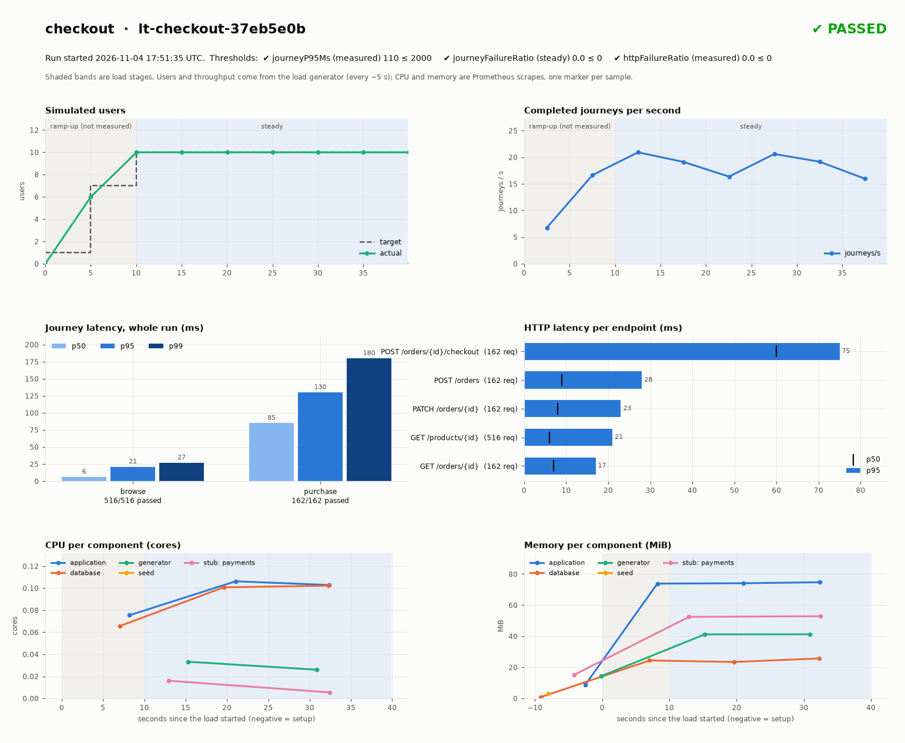

# Example output

This is the complete, unedited output of one run of the sample test:

```bash
./loadtest run LoadTestDefinitions/checkout.yaml
```

Run [`lt-checkout-37eb5e0b`](lt-checkout-37eb5e0b/) **passed** (exit code 0) in 70 s. The only
change from what `.runtime/runs/<run-id>/` contains is that the absolute path of the checkout
was replaced with a relative one, and the downloaded chart archive and lock file were left out.



## Headline numbers

| | Result |
| --- | --- |
| Load | 10 users, each repeating *browse 3 products → wait 2 s → purchase*; 10 s ramp-up, 30 s measured |
| Journeys | `browse` 516/516 passed (p95 21 ms) · `purchase` 162/162 passed (p95 130 ms) |
| Thresholds | journey p95 110 ms ≤ 2000 ✔ · journey failures 0 ✔ · HTTP failures 0 ✔ |
| Peak CPU / memory | application 0.11 cores / 75 MiB · database 0.10 / 26 MiB · load generator 0.03 / 41 MiB · payments stub 0.02 / 53 MiB |
| Guardrails | 5 Pods planned, 4.5 CPU / 1536Mi of limits against an 8 CPU / 8Gi namespace quota; default-deny NetworkPolicy |

## What each file is

| File | What it shows |
| --- | --- |
| [`report.md`](lt-checkout-37eb5e0b/report.md) | **Start here.** The readable summary: dashboard, thresholds, stages, journeys, resource usage, pinned artifacts |
| [`dashboard.png`](lt-checkout-37eb5e0b/dashboard.png) | Users, throughput, latency per journey and per endpoint, CPU and memory per component |
| [`console.log`](lt-checkout-37eb5e0b/console.log) | What the developer saw in the terminal, ending with the JSON summary |
| [`testresult.json`](lt-checkout-37eb5e0b/testresult.json) | The structured result, for CI gates and comparisons between runs |
| [`progress.log`](lt-checkout-37eb5e0b/progress.log), [`events.jsonl`](lt-checkout-37eb5e0b/events.jsonl) | The live progress log, and the same events as structured JSON |
| [`guardrails.json`](lt-checkout-37eb5e0b/guardrails.json) | The resource plan accepted by the pre-flight check and the LimitRange, ResourceQuota and NetworkPolicies applied |
| [`metrics/`](lt-checkout-37eb5e0b/metrics/) | Prometheus data: `resource-usage.csv` (one row per sample), `series.json` (raw), `resource-usage.json` (peaks and means per component) |
| [`run.json`](lt-checkout-37eb5e0b/run.json) | The run record: phases and durations, outcome, errors, what was cleaned up |
| [`resolved/`](lt-checkout-37eb5e0b/resolved/) | What the names in the definition resolved to: every artifact pinned to a digest |
| [`suite/`](lt-checkout-37eb5e0b/suite/) | The load generator's Job, its log and its raw result |
| [`database/`](lt-checkout-37eb5e0b/database/) | The PostgreSQL setup and seed Job record and log |
| [`applications/`](lt-checkout-37eb5e0b/applications/) | The Helm values and deployment record for the application and the payments stub |
| [`diagnostics/`](lt-checkout-37eb5e0b/diagnostics/) | Every container's log, Kubernetes events and resources, captured before the namespace was deleted |

Generated database credentials never appear in any file: they live only in a Secret inside the
test namespace, which is deleted at the end of the run.
