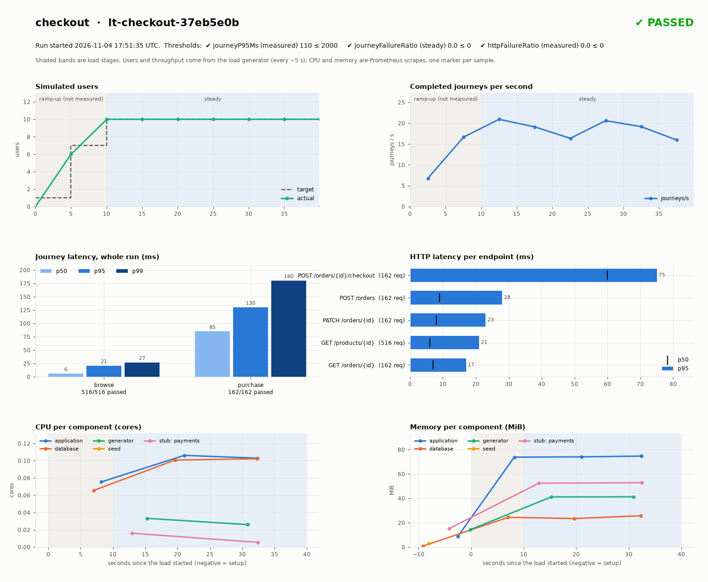

# checkout — PASSED

Run `lt-checkout-37eb5e0b` · exit code 0

| Execution | Performance | Collection | Cleanup |
| --- | --- | --- | --- |
| completed | passed | ok | ok |

Suite ran 2026-11-04T17:51:46.214492+00:00 → 2026-11-04T17:52:26.178904+00:00 (run 2026-11-04T17:51:35.443320+00:00 → 2026-11-04T17:52:45.747836+00:00).

## Limitations
- CPU unavailable for seed: a rate needs two scrapes and these Pods lived too briefly; memory had a single sample. Use a longer profile for CPU evidence.

## Thresholds
| Scope | Metric | Max | Actual | Samples | Outcome |
| --- | --- | --- | --- | --- | --- |
| measured | journeyP95Ms | 2000 | 110 | 560 | passed |
| steady | journeyFailureRatio | 0 | 0.0 | 560 | passed |
| measured | httpFailureRatio | 0 | 0.0 | 980 | passed |

## Stages
| Stage | Mode | Users | Measured | Journeys | Failures | Journey p95 ms | HTTP p95 ms |
| --- | --- | --- | --- | --- | --- | --- | --- |
| ramp-up | ramp 10s | 10 | no | 118 | 0 | 87 | 60 |
| steady | hold 30s | 10 | yes | 560 | 0 | 110 | 63 |

## Journeys
| Journey | Attempted | Passed | Failed | p95 ms |
| --- | --- | --- | --- | --- |
| browse | 516 | 516 | 0 | 21 |
| purchase | 162 | 162 | 0 | 130 |

## Resource usage
Prometheus window 2026-11-05T00:51:35.946424+07:00 → 2026-11-05T00:52:45.620578+07:00.
| Role | CPU peak (cores) | CPU mean | Memory peak (MiB) |
| --- | --- | --- | --- |
| application | 0.106 | 0.095 | 75 |
| database | 0.102 | 0.090 | 26 |
| generator | 0.033 | 0.030 | 41 |
| seed | no samples | - | 3 |
| service:payments | 0.016 | 0.011 | 53 |

## Artifacts
- application: `localhost:5001/performance/checkout@sha256:b5a2cac6b5481f49b0a0a4bfa682fda11190e5a33638ce1d56d5374d2492551d`
- applicationDefinition: `localhost:5001/performance/applications/checkout@sha256:d14c0e2589d992e645c736419e1d505b837fbea4ef5c57aafa29cfaf1115680d`
- chart: `localhost:5001/performance/charts/http-service@sha256:3b049d3ac60e04aaed650c1b13a723b6f8d352bd893e75797d42d91d5b57fc4d`
- database: `localhost:5001/performance/postgres@sha256:ac74e8c63c516b1f81fbaaede0663981399f80e42369431136b2455557f8547b`
- scripts: `localhost:5001/performance/suites/checkout@sha256:05b5a30560a252821d85f1f2a34dbdb1bf6fcee37ea2ac86418f7739f631c3db`
- service.payments: `localhost:5001/performance/checkout@sha256:b5a2cac6b5481f49b0a0a4bfa682fda11190e5a33638ce1d56d5374d2492551d`
- setup: `localhost:5001/performance/checkout@sha256:b5a2cac6b5481f49b0a0a4bfa682fda11190e5a33638ce1d56d5374d2492551d`
- suiteRuntime: `localhost:5001/performance/python-suite@sha256:bc1bb4d2b401aebb9ac37d8ec5ba295b67b6e239c5b3326a8a2fc9f9a389da36`

## Evidence (relative to the run directory)
- progress: `progress.log`
- progressEvents: `events.jsonl`
- record: `run.json`
- resolvedSnapshot: `resolved/resolved.json`
- suiteResult: `suite/result.json`
- suiteLog: `suite/suite.log`
- suiteJob: `suite/job.json`
- databaseRecord: `database/result.json`
- seedLog: `database/seed/seed.log`
- diagnostics: `diagnostics`
- resourceUsage: `metrics/resource-usage.json`
- resourceSeries: `metrics/series.json`
- resourceCsv: `metrics/resource-usage.csv`
- dashboard: `dashboard.png`
